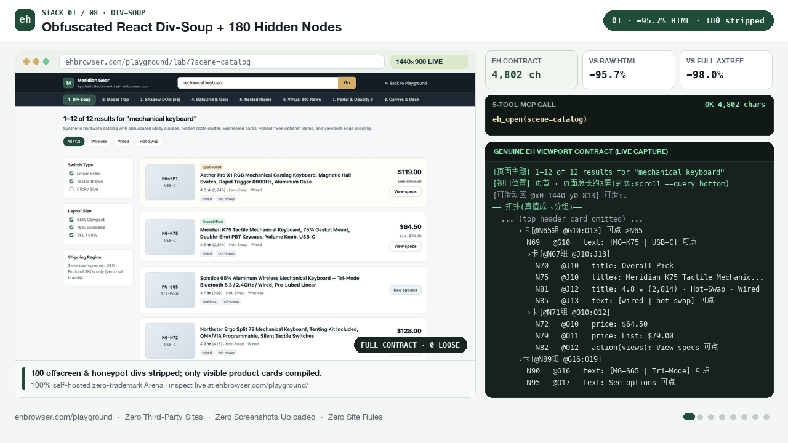
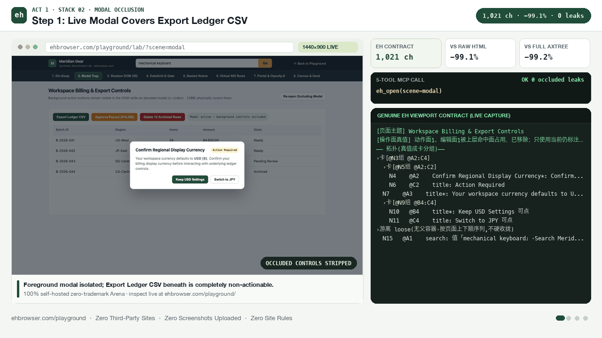
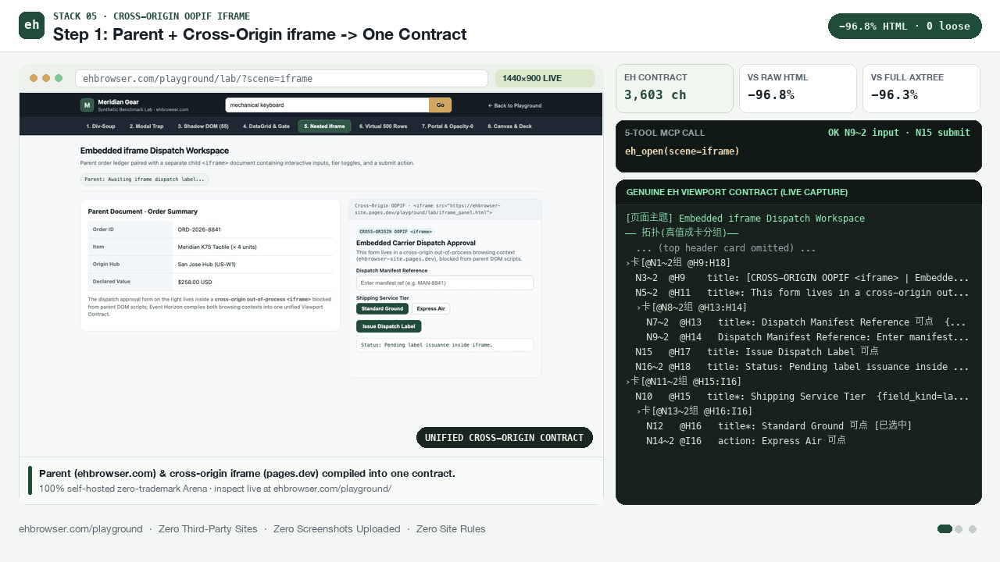
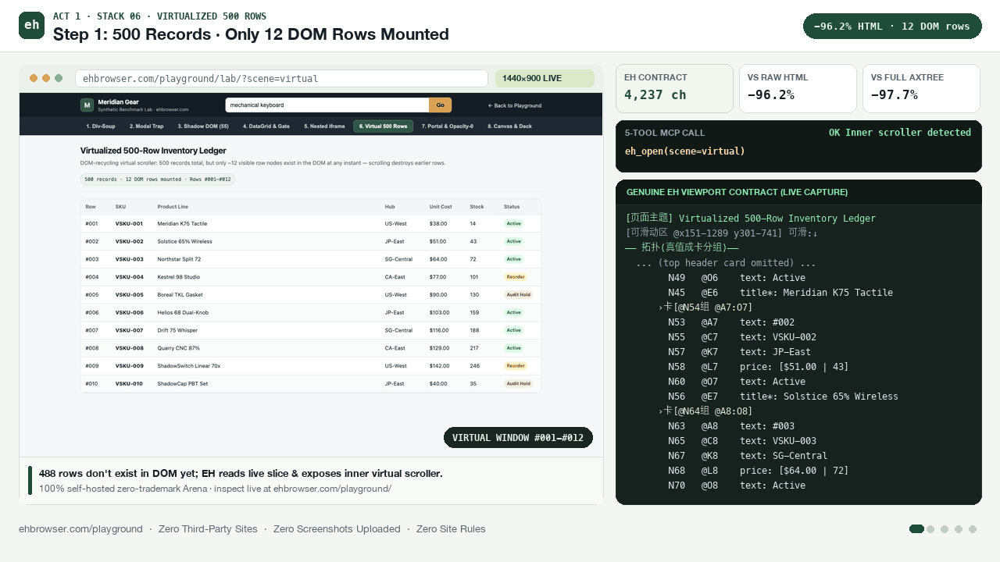
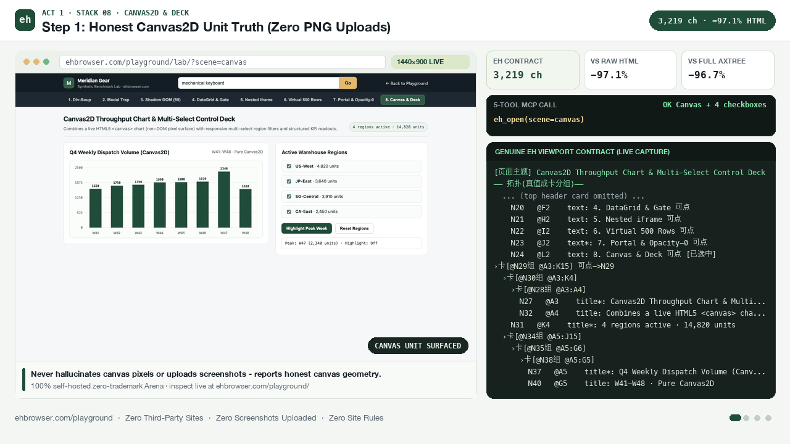

<div align="center">

# Event Horizon

### The Human-Visible Reality Layer for AI Browser Agents

**Compiled Viewport Perception over MCP — 95%+ smaller context across 8 hostile frontend stacks, 0 occluded clicks, zero site rules.**

[English](README.md) · [中文](README.zh-CN.md) · [8-Stack Interactive Arena (Zero Login)](https://ehbrowser.com/playground/) · [Website](https://ehbrowser.com/) · [Changelog](CHANGELOG.md) · [Quickstart (100% Free)](#60-second-quickstart-100-free--register--use) · [Why Hosted & Free](#why-is-the-perception-core-hosted)

</div>

---

## The Problem Isn't Your LLM. It's the Fake Layout You Feed It.

**Websites were built for human eyes — not DOM trees.**

Most browser agents don't fail because frontier models lack intelligence. They fail because today's tooling hands the model a **distorted reality**:

- **Raw DOM / Accessibility Tree dumpers** (`Playwright MCP`, DevTools trees) flood context with **200,000+ offscreen tokens**, expose buttons buried behind live modals as "clickable", and never tell the model when a card is cut off at the bottom of the screen.
- **Pixel / Screenshot agents** (`Computer Use`, vision loops) burn latency and tokens guessing `(x, y)` coordinates, shatter when a window resizes or zooms, miss hidden inline editors, and stream user screenshots to cloud servers.

**Event Horizon opens a new category: Compiled Viewport Perception.**

Instead of dumping raw HTML/AX trees or streaming screenshots, Event Horizon compiles what is **physically visible and actionable inside your browser viewport** into a compact, structured **Viewport Contract** — and enforces hard execution safety before a single click touches the DOM.

---

## Three Simple Ideas Behind the Reality Layer

Strip away colors, textures, and framework noise from any webpage, and only two things remain: **geometry** (position, boundaries, containment) and **semantics** (roles, labels, headers). Everything in Event Horizon follows naturally from three simple ideas you can verify on your own screen right now:

1. **Geometric Navigation** — Humans don't read a 200,000-token DOM tree. They see clusters of bounded geometry (cards, rows, controls) forming a 2D map of what exists and where to click.
2. **Clipping & Occlusion as Signals** — When a card is cut off at the bottom edge of the viewport, that clipped edge *is* the signal that more content lies below (and likewise up, left, or right). When a modal or overlay covers geometry underneath, handle the foreground layer first before reading beneath it.
3. **Exploration Convergence** — When exploring the viewport stops yielding new visible geometry, the agent has a principled signal to stop.

*Event Horizon is simply the engineering expression of these three ideas — aligning what the model sees with the shared visual layer humans actually navigate.*

---

## A New Layer in the Browser Agent Stack

| Dimension | Track 1: Raw DOM / AX Tree<br>*(Playwright MCP, etc.)* | Track 2: Vision / Pixel Loops<br>*(Computer Use, Vision BU)* | **Track 3: Compiled Viewport Perception**<br>***Event Horizon*** |
| :--- | :--- | :--- | :--- |
| **What the model sees** | Full hidden/offscreen document tree (`112k–235k ch/screen`) | Heavy PNG screenshots (`(x, y)` guessing) | **Compact Visible Viewport Contract (`1.0k–5.2k ch`, `-95.3% to -99.1%`)** |
| **Occluded modal controls** | Exposed as clickable behind backdrop | Guesses through visual clutter | **Stripped before reasoning (`0` occluded leaks)** |
| **Shadow DOM, OOPIF iframe & Portals** | SOP blocked / fragile selectors / tree bloat | Blind to structure & tiny controls | **55 ShadowRoots + Cross-Origin OOPIF + Body Portals unified · 0 site rules** |
| **Virtualized lists (DOM recycling)** | Unmounted rows missing; scrolling destroys rows | Re-reads screenshots every scroll | **Inner virtual scroller + frozen `E*` evidence survives DOM recycle** |
| **Canvas2D & transparent button covers** | Misses `opacity:0` shells or leaks backdrops | Uploads heavy PNGs every turn | **Honest canvas geometry (0 PNGs) + exact `opacity:0` native binding** |
| **High-risk actions** | Prompt-only (*"please don't log in"*) | Prompt-only | **Code-enforced Pre-DOM Safety Gate (`dom_touched: false`)** |
| **Browser, IP & Privacy** | Cloud browser or heavy local deps | Screenshots sent to cloud VLMs | **Your local Chrome · No screenshots · Zero content retention** |

---

## Proof: 8-Stack Frontend Arena (100% Self-Hosted & Reproducible)

Instead of cherry-picking third-party websites, every recording and measurement below runs against our **100% self-hosted, zero-trademark [8-Stack Frontend Arena](https://ehbrowser.com/playground/)** ([live source lab](https://ehbrowser.com/playground/lab/)). Open it in your browser, press **F12**, and inspect every DOM trap, ShadowRoot, cross-origin `<iframe>`, virtualized row, and compiled Viewport Contract yourself.

### 1. Eight Hostile Frontend Stacks → One Unified Viewport Contract

<p align="center">
  
</p>

| Self-Hosted Arena Stack (`1440×900` · Inspect via F12) | Raw DOM HTML | Full AXTree | **Event Horizon Contract & Verified Action** |
| :--- | :---: | :---: | :--- |
| **1. Obfuscated Div-Soup Catalog** *(180 hidden noise nodes)* | `112,040 ch` | `235,649 ch` | **`4,802 → 3,168 ch`** (`-95.7% / -98.0%`) · Delta scroll + `E0` ✓ |
| **2. Modal Physical Occlusion Trap** *(`z-index: 1200`)* | `112,034 ch` | `120,910 ch` | **`1,021 ch`** (`-99.1% / -99.2%`) · **0 leaks** → Unlock CSV ✓ |
| **3. 55 Nested Open ShadowRoots** *(0 light-DOM SKUs)* | `112,031 ch` | `225,045 ch` | **`5,229 ch`** (`-95.3% / -97.7%`) · Click `N70` → `Selected ✓` |
| **4. ARIA Combobox + DataGrid + Protected Boundary** | `112,040 ch` | `124,585 ch` | **`3,939 ch`** (`-96.5% / -96.8%`) · Sign-in & Password **BLOCKED** ✓ |
| **5. Cross-Origin OOPIF `<iframe>`** *(`ehbrowser.com → pages.dev`)* | `112,038 ch` | `98,006 ch` | **`3,603 ch`** (`-96.8% / -96.3%`) · Fill `N9~2` + Submit `N15` ✓ |
| **6. Virtualized 500-Row Ledger** *(only 12 DOM rows mounted)* | `112,040 ch` | `184,232 ch` | **`4,237 → 3,820 ch`** (`-96.2% / -97.7%`) · `E0` survives DOM recycle ✓ |
| **7. Body-Mounted Calendar Portal + `opacity:0` Native Shell** | `112,045 ch` | `119,112 ch` | **`2,902 ch`** (`-97.4% / -97.6%`) · Pick Dec 18 + Confirm ✓ |
| **8. HTML5 Canvas2D Chart + Multi-Select Region Deck** | `112,041 ch` | `98,054 ch` | **`3,219 ch`** (`-97.1% / -96.7%`) · Honest canvas + W47 redraw ✓ |

> *100% live-captured directly from the Event Horizon engine at `1440×900` with zero site rules, zero screenshots uploaded, and zero `<html>` loose leaks. Try all 8 contracts interactively with zero login at [ehbrowser.com/playground/](https://ehbrowser.com/playground/).*

---

### 2. Modal Occlusion Isolation (`0` Leaks) + 55 Open ShadowRoots Pierced & Clicked

- **Act 1 (Modal Trap)**: While the `z-index: 1200` currency modal is active, Event Horizon emits only the `1,021`-char foreground dialog (`-99.1%`), completely removing occluded controls (`Export Ledger CSV`) until clicking `Keep USD Settings` unlocks `N46`.
- **Act 2 (55 ShadowRoots)**: With `0` light-DOM SKU nodes inside 55 nested open `#shadow-root` trees, EH pierces every boundary with zero CSS selectors and clicks `Inspect SKU` (`N70`) → verified **`Selected ✓`**.

<p align="center">
  
</p>

---

### 3. Cross-Origin OOPIF `<iframe>` Unified Fill & Dual-Frame Submit

Standard DOM dumpers hit a hard Same-Origin Policy wall (`SecurityError`) on cross-origin iframes. Event Horizon lifts both the parent document (`ehbrowser.com`) and the cross-origin out-of-process `<iframe>` (`ehbrowser-site.pages.dev`) into ONE unified contract — filling **`MAN8841`** into disambiguated ID **`N9~2`** (while leaving the top search bar untouched) and clicking **`N15`** to verify **`Label Issued · MAN8841 · Standard Ground ✓`** in both frames.

<p align="center">
  
</p>

---

### 4. Virtualized 500-Row List (`E0` Freeze) + Detached Body Portal & `opacity:0` Native Shell

- **Act 1 (DOM-Recycling Virtual List)**: Out of 500 records, only ~12 rows exist in the DOM at once. EH freezes `VSKU-002` as audited cross-scroll evidence **`E0`** before scrolling the inner virtual container (`#001–#012` → `#007–#018`) destroys row `#002` from the DOM — keeping `E0` grounded in the delta contract.
- **Act 2 (Body Portal + `opacity:0` Cover)**: Opens a calendar popover mounted directly on `document.body` outside the form subtree, selects **Dec 18 (`2026-12-18`)**, and clicks the `opacity:0` native confirm button shell → verified **`Schedule Confirmed ✓`**.

<p align="center">
  
</p>

---

### 5. Honest HTML5 Canvas2D Truth (Zero PNG Uploads) + Code-Enforced Pre-DOM Safety Gate

- **Act 1 (Canvas2D)**: Instead of uploading multi-megabyte screenshots or hallucinating chart pixels, EH surfaces honest canvas unit geometry alongside live region checkboxes and clicks `Highlight Peak Week` (`N59`) — redrawing week **W47** in amber and verifying **`Highlight: On ✓`**.
- **Act 2 (Pre-DOM Hard Safety Gate)**: Both clicking `Sign in` (`N70`) and typing into `type="password"` (`N64`) are **hard-blocked in code before touching the DOM** (`ok: false`, `dom_touched: false`) — immune to prompt injection.

<p align="center">
  
</p>

---

### 6. Beyond Cherry-Picked Pages: 300-Run Multi-Site Scale & Cost Archive (NL50)

Short demos are easy to stage. To test stability and real API economics at scale, an archived baseline suite (**NL50**, 50 multi-step tasks × 3 cold runs + 3 experience-assisted runs, zero human takeover, DeepSeek V4 Flash) ran continuously across dozens of live public sites:

| Archived Scale Metric (NL50) | Measured Value |
| :--- | :--- |
| **Total End-to-End Runs** | **`300`** (`150` cold + `150` experience-assisted · `0` human takeovers) |
| **URL-Bearing Page States** | **`3,680`** |
| **Distinct URLs Visited** | **`498`** (mean `3.9` / median `3` / max **`39`** distinct URLs per run) |
| **Distinct Hostnames / Real Sites** | **`88`** hostnames across **`51`** distinct sites (`eTLD+1`) |
| **Total LLM Model Cost (All 300 Runs)** | **`$5.52`** (`$2.81` cold + `$2.70` exp ≈ **`$0.0184` per run**) |
| **Prompt Input Cache Hit Rate** | **`95.6%`** across `5,245` LLM calls (`95.63%` cold / `95.51%` exp) |
| **Original Frozen Delivery Gate** | **`298 / 300`** (`149/150` per arm) · `234` invalid/unsafe actions caught pre-execution |

> *Archive honesty note: These figures come from a prior frozen engine benchmark (not rerun on the current subscription build). Passing the original frozen delivery check does not equal field-by-field human fact verification, and the 51 historical sites are not a guaranteed compatibility list. Full methodology, strict blind-audit context, and original records are preserved in [Historical Evidence & Review Materials](docs/DEMO_EVIDENCE.en.md).*

---

## What Your Agent Actually Sees

Instead of 90,000 tokens of raw HTML or a noisy screenshot, your agent receives a compact **Viewport Contract** aligned with human visual truth:

```text
[Page] Embedded iframe Dispatch Workspace (ehbrowser.com)
[Cross-Origin OOPIF] Parent + pages.dev <iframe> compiled into ONE unified contract
[Frozen Evidence] E0 "VSKU-002 · Solstice 65% Wireless · $51.00" (survives virtual DOM recycle)

▸Card[@N35 @B8:E15]  Parent Document · Order Summary
  N42   @E9    Order ID*: ORD-2026-8841   {field_source=table_row_th}
  N47   @E11   Item*: Meridian K75 Tactile (× 4 units)
  N53   @E14   Declared Value: $258.00 USD
▸Card[@N1~2 @I10:J20]  Cross-Origin OOPIF <iframe>
  N9~2  @I15   Dispatch Manifest Reference: 「MAN8841」 editable
  N12   @I18   Standard Ground clickable [selected]
  N15   @I19   Issue Dispatch Label clickable
  N16~2 @I20   Status: Label Issued · MAN8841 · Standard Ground ✓
```

- **Zero Phantom Clicks**: Occluded controls are removed before the LLM ever sees them.
- **Self-Describing Table Values**: Column headers bind straight to cell values so even lightweight models never misread columns.
- **Explicit Viewport Boundaries (`⚠ clipped-bottom`)**: The model knows *exactly* when a card is cut off and needs a scroll — and when exploration is genuinely complete.
- **Grounded Evidence (`E*`)**: Facts extracted on earlier pages stay frozen and bound to visible nodes; if a field isn't on the page, the agent reports it honestly instead of hallucinating.

---

## Architecture & Zero-Retention Trust Model

```text
┌─────────────────────────────┐         MCP (stdio)         ┌──────────────────────────────────┐
│  Your AI Agent Host         │ ◄─────────────────────────► │  Auditable Thin Client (This Repo)│
│  Claude Code / Cursor /     │                             │  Pure Python stdlib · 0 third-   │
│  Codex / OpenCode / Custom  │                             │  party deps · inspect every line │
└─────────────────────────────┘                             └──────────┬─────────────┬─────────┘
                                                                       │             │
                                            Local CDP (127.0.0.1)      │             │ TLS (Compact DOM
                                            Your IP · Your Cookies     │             │ sample only · NO
                                                                       ▼             │ screenshots)
                                                            ┌──────────────────┐     ▼
                                                            │ Your Local Chrome│  ┌──────────────────────┐
                                                            │ (Isolated Profile│  │ EH Perception Engine │
                                                            │  on Your Machine)│  │ Ephemeral RAM only   │
                                                            └──────────────────┘  │ Zero persistence     │
                                                                                  └──────────────────────┘
```

- **Your Chrome, Your IP, Your Cookies**: Browsing happens strictly inside an isolated Chrome instance on **your machine** — never on a shared cloud IP that gets instantly CAPTCHA-walled.
- **Auditable Zero-Dependency Thin Client**: This repository contains only the pure Python standard-library thin client, local console, browser connector, and MCP skill. Audit every file yourself to verify that passwords, cookies, and API keys stay local.
- **No Screenshots Uploaded · Zero Content Persistence**: Server-side screenshot capture is disabled; page samples are processed in bounded ephemeral RAM (max 15 minutes) and never written to persistent storage.
- **Plain-Text Server Notices**: The local console can display read-only server status & maintenance notices (strictly plain text + optional `https://` links — zero executable code).
- **Bring Your Own Model & Agent**: Event Horizon never locks you into an expensive bundled LLM. Plug it into **Claude Code, Cursor, Codex, OpenCode**, or any local MCP host.

---

## Why Is the Perception Core Hosted?

Two straightforward reasons:

1. **Core protection:** The viewport compilation core is an independently built engine that I am keeping closed-source for now.
2. **Practical legal & abuse control:** Browser automation carries real legal, compliance, and misuse risks. Hosting the core lets me keep hard server-side blocks on high-sensitivity targets (**banking, payments, medical portals, and credential entry**) and stop abuse quickly when needed.

To keep the trust boundary verifiable, this local thin client is **100% open-source (`AGPL-3.0-only`), pure Python stdlib with zero third-party dependencies**, and launches an isolated local Chrome profile on your own machine — your cookies and IP stay local, and you can audit every byte sent over TLS in the source code.

**Event Horizon is 100% free for personal use — register and use immediately.** No paywall, no credit card, no activation code, no ads, no screenshots uploaded, and zero page-content retention (only lightweight single-concurrency fair-use guardrails keep the shared server responsive for everyone). If EH saves you tokens or engineering hours, voluntary sponsorship on [Afdian (爱发电)](https://ifdian.net/a/ehbrowser?tab=home) helps cover server costs.

---

## 60-Second Quickstart (100% Free · Register & Use)

**Don't take a benchmark's word for it — test it on your nastiest page in 60 seconds.**

**Prerequisites**: Python 3.10+, Google Chrome, and any local MCP-capable agent (Claude Code, Cursor, Codex, etc.). Zero `pip install` required.

### 1. Clone & Start the Local Thin Client

**macOS / Linux:**
```sh
git clone https://github.com/Boundprogress/Event-horizon-MCP.git
cd Event-horizon-MCP
python3 -I -S -B eh.py start
```

**Windows PowerShell:**
```powershell
git clone https://github.com/Boundprogress/Event-horizon-MCP.git
cd Event-horizon-MCP
py -3 -I -S -B eh.py start
```

### 2. Sign In & Connect Your Agent (100% Free)

1. The local console opens automatically in your browser (defaults to **English** on non-Chinese locales; switch anytime in the sidebar).
2. **Sign in with one click using GitHub or Google** (no form or 6-digit verification code needed), or register with email &amp; password — access is **100% free** (no waitlist, no activation code, no credit card).
3. Click **Prepare Local Setup** → **Connect Browser** to launch your isolated local Chrome.
4. Click **Copy One-Line MCP Setup** and paste it into **Claude Code / Cursor / Codex / OpenCode** — or any ACP / shell-capable desktop agent. The generated connection package automatically adapts across three tiers (without ever exposing your API key):
   - **Tier 1 (Native stdio MCP)**: `mcp-config.json` / Codex TOML (`eh_*` tools).
   - **Tier 2 (ACP `session/new` & Python SDK)**: `acp-mcp-servers.json` (standard Agent Client Protocol `mcpServers` array, or `python3 -I -S -B client.py mcp-config --console-directory <dir> --host acp`) and zero-dependency [`eh_sdk.py`](eh_sdk.py) (`EventHorizonClient.from_console()` / `.acp_mcp_servers()`).
   - **Tier 3 (Non-MCP Desktop Hosts with Shell Access)**: Bound credential-free CLI fallback (`python3 -I -S -B client.py tool --console-directory <dir> --name eh_status --args '{}'`) exposing all 17 tools and schemas identically.

### 3. Optional: Python SDK & ACP Integration (Zero `pip install`)

```python
from eh_sdk import EventHorizonClient

eh = EventHorizonClient.from_console()

# Pass directly into an ACP (Agent Client Protocol) session/new payload:
acp_mcp_servers = eh.acp_mcp_servers()

# Or drive your connected local Chrome directly from Python:
session = eh.open_session("Check latest release", "https://www.python.org/")
obs = session.perceive()
session.close()
```

> Full client setup & troubleshooting: [Client Docs](docs/README.en.md) · [Capabilities](docs/CAPABILITIES.en.md) · [FAQ](docs/FAQ.en.md) · [Comparison with Browser Use & Playwright MCP](docs/BROWSER_USE_COMPARISON.en.md)

---

## Honest Scope & Boundaries

We prefer engineering honesty over demo magic:

- **Public Beta**: Event Horizon is actively evolving; complex websites can still fail, time out, or require retries. Always verify critical outputs against the live page.
- **100% Free · Fair-Use Guardrails**: Event Horizon is free to use upon registration with no paywall or activation codes. Accounts run under single-concurrency fair-use limits (`max_sessions=1, max_commands=1`) to protect shared server stability; abusive scraping or DoS traffic may be suspended. Your own LLM/agent provider costs are separate.
- **Restricted Domains**: Standard public HTTP(S) sites require no per-site allowlist, while private networks and high-sensitivity categories (**banking, payments, medical portals, credential entry**) are restricted by design.
- **Zero-Retention Note**: Although your Chrome runs locally, compact page samples are sent over TLS to the Event Horizon perception service for compilation. Please review the Service Agreement shown inside the client before use.

---

## Support the Project & Throw Your Nastiest Page At Us

Event Horizon is independently built and maintained.

- **Report a tough site or bug**: Open a GitHub Issue with the public URL and what broke — real-world failure cases drive our roadmap.
- **Sponsor server costs**: If Event Horizon cuts your agent token bills or saves engineering time, voluntary sponsorship via [Afdian (爱发电)](https://ifdian.net/a/ehbrowser?tab=home) helps keep the hosted perception service free and online (§1.4).
- **Contact, feedback & appeals**: [pluto@ehbrowser.com](mailto:pluto@ehbrowser.com) · Website & Terms: [https://ehbrowser.com](https://ehbrowser.com/) / [https://ehbrowser.com/terms](https://ehbrowser.com/terms/).

---

## License

This thin client repository is licensed under **GNU Affero General Public License v3.0 only (`AGPL-3.0-only`)**. See [LICENSE](LICENSE) and [NOTICE](NOTICE). Use of the companion hosted perception service is governed by the Service Agreement displayed in the client.
