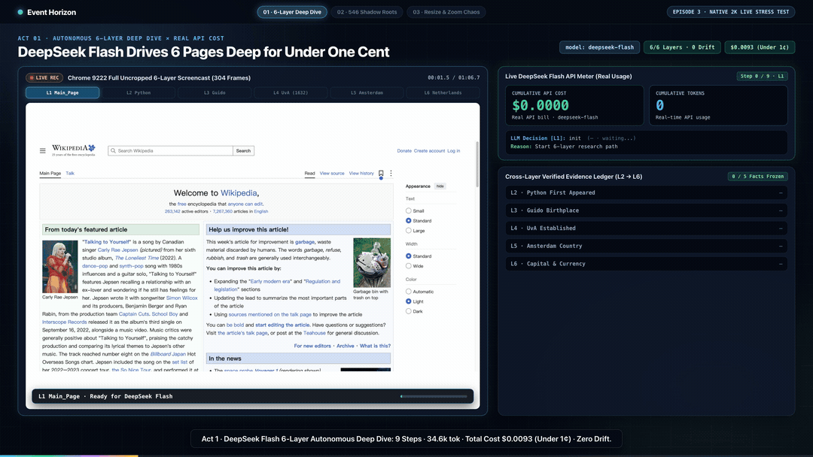
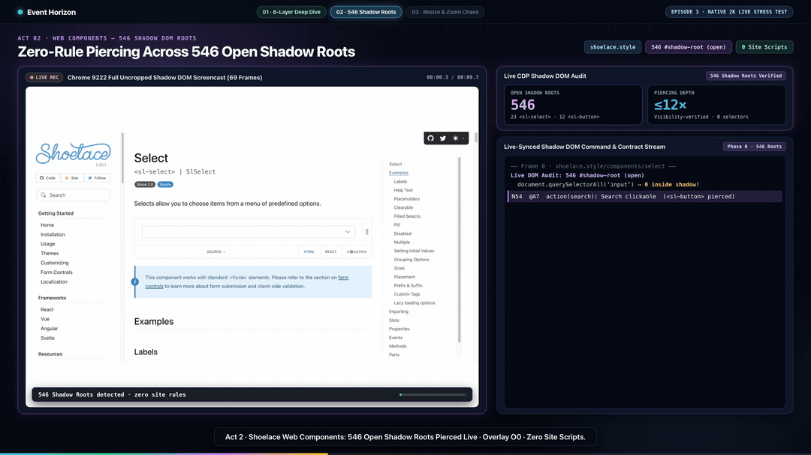
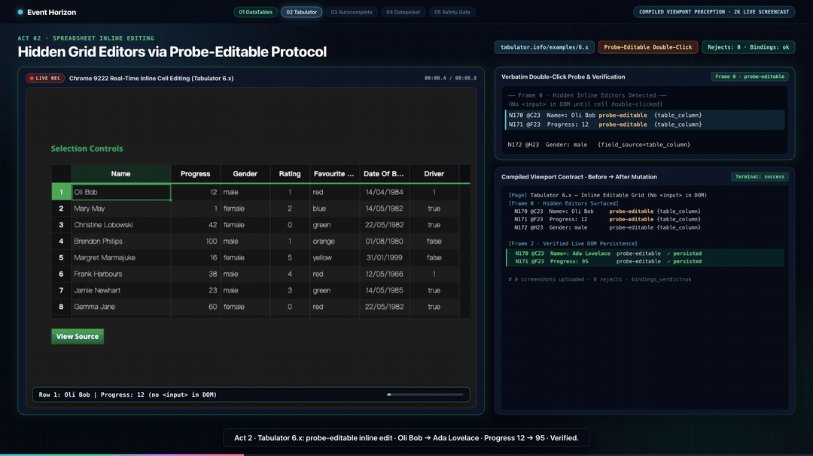

<div align="center">

# Event Horizon

### The Human-Visible Reality Layer for AI Browser Agents

**Compiled Viewport Perception over MCP — 91.9% fewer tokens, 0 occluded clicks, zero site rules.**

[English](README.md) · [中文](README.zh-CN.md) · [Website](https://ehbrowser.com/) · [Quickstart (100% Free)](#60-second-quickstart-100-free--register--use) · [Benchmarks](#proof-compiled-perception-vs-dom--vision) · [Why Hosted & Free](#why-is-the-perception-core-hosted)

</div>

---

## The Problem Isn't Your LLM. It's the Fake Layout You Feed It.

**Websites were built for human eyes — not DOM trees.**

Most browser agents don't fail because frontier models lack intelligence. They fail because today's tooling hands the model a **distorted reality**:

- **Raw DOM / Accessibility Tree dumpers** (`Playwright MCP`, DevTools trees) flood context with **200,000+ offscreen tokens**, expose buttons buried behind live modals as "clickable", and never tell the model when a card is cut off at the bottom of the screen.
- **Pixel / Screenshot agents** (`Computer Use`, vision loops) burn latency and tokens guessing `(x, y)` coordinates, shatter when a window resizes or zooms, miss hidden inline editors, and stream user screenshots to cloud servers.

**Event Horizon opens a new category: Compiled Viewport Perception.**

Instead of dumping raw HTML/AX trees or streaming screenshots, Event Horizon compiles what is **physically visible and actionable inside your browser viewport** into a compact, structured **Viewport Contract** — and enforces hard execution safety before a single click touches the DOM.

---

## Three Simple Ideas Behind the Reality Layer

Strip away colors, textures, and framework noise from any webpage, and only two things remain: **geometry** (position, boundaries, containment) and **semantics** (roles, labels, headers). Everything in Event Horizon follows naturally from three simple ideas you can verify on your own screen right now:

1. **Geometric Navigation** — Humans don't read a 200,000-token DOM tree. They see clusters of bounded geometry (cards, rows, controls) forming a 2D map of what exists and where to click.
2. **Clipping & Occlusion as Signals** — When a card is cut off at the bottom edge of the viewport, that clipped edge *is* the signal that more content lies below (and likewise up, left, or right). When a modal or overlay covers geometry underneath, handle the foreground layer first before reading beneath it.
3. **Exploration Convergence** — When exploring the viewport stops yielding new visible geometry, the agent has a principled signal to stop.

*Event Horizon is simply the engineering expression of these three ideas — aligning what the model sees with the shared visual layer humans actually navigate.*

---

## A New Layer in the Browser Agent Stack

| Dimension | Track 1: Raw DOM / AX Tree<br>*(Playwright MCP, etc.)* | Track 2: Vision / Pixel Loops<br>*(Computer Use, Vision BU)* | **Track 3: Compiled Viewport Perception**<br>***Event Horizon*** |
| :--- | :--- | :--- | :--- |
| **What the model sees** | Full hidden/offscreen document tree (`200k+ tok`) | Heavy PNG screenshots (`(x, y)` guessing) | **Compact Visible Viewport Contract (`16.3k tok`)** |
| **Occluded modal controls** | Exposed as clickable (`85 / 90` leaked) | Guesses through visual clutter | **Stripped before reasoning (`0 / 90` leaked)** |
| **Shadow DOM & `div`-soup** | Fragile selectors / massive tree bloat | Blind to structure & tiny cells | **546 open Shadow Roots pierced · 0 site rules** |
| **Live resize & page zoom** | Stale refs / broken coordinates | Coordinate drift & misclicks | **Viewport-recompiled mid-task · 0 missed clicks** |
| **Hidden inline editors** | Misses cells with no `<input>` in DOM | Unreliable double-click guessing | **Probe-editable detection & verified mutation** |
| **High-risk actions** | Prompt-only (*"please don't log in"*) | Prompt-only | **Code-enforced Pre-DOM Safety Gate** |
| **Browser, IP & Privacy** | Cloud browser or heavy local deps | Screenshots sent to cloud VLMs | **Your local Chrome · No screenshots · Zero content retention** |

---

## Proof: Compiled Perception vs. DOM & Vision

### 1. 91.9% Fewer Tokens & Zero Occluded Leaks (3-Way Live 2K Benchmark)

Head-to-head on the exact same 2K viewport (`2560×1440`) using `deepseek-flash` (`temp=0`) across 5 notoriously hard public pages:

<p align="center">
  
</p>

| Hard Public Page | Playwright MCP | Browser Use 1.0.6 | **Event Horizon** |
| :--- | :---: | :---: | :---: |
| **1. Apple SEC 10-K Financial Table** | `93,169 tok` · PASS | `45,365*` · **FAIL (Cut Off)** | **`3,538 tok` (26× smaller) · PASS** |
| **2. Wikipedia Multi-Header Table** | `38,874 tok` · PASS | `11,788 tok` · PASS | **`3,828 tok` · PASS** |
| **3. Bootstrap 5.3 Live Modal (90 covered)** | `16,880 tok` · **85 leaks** | `8,999 tok` · **82 leaks** | **`375 tok` · 0 leaks** |
| **4. UN 240-Row Long Table** | `49,588 tok` · NO FOLD | `14,793 tok` · NO FOLD | **`4,989 tok` · PASS** |
| **5. arXiv Advanced Form** | `2,314 tok` · PASS | `1,383 tok` · PASS | **`3,606 tok` · PASS** |
| **5-Page Total Context / Delivery** | **`200,825 tok` · 3/5** | **`82,328 tok` · 2/5** | **`16,336 tok` (-91.9%) · 4/5*** |

> *Benchmark note: Measured on the 5 listed public pages under a fixed 2K viewport with `deepseek-flash`. Figures reflect this controlled suite and do not guarantee identical compression or completion rates on every website.*

---

### 2. Six Pages Deep for Under 1¢ (`$0.0093` Total · Zero Drift)

Autonomous 6-layer research dive driven live by `deepseek-flash` (`Wikipedia Main Page → Python → Guido van Rossum → University of Amsterdam → Amsterdam → Netherlands`). Context stays flat at **~3,800 tokens/step** across **9 live calls** (`34,581 tok` total), extracting **5/5 cross-layer facts** with zero hallucination.

<p align="center">
  
</p>

---

### 3. 546 Open Shadow DOM Roots Pierced — Zero Site Rules

On `shoelace.style` (pure Web Components), Event Horizon pierces **546 open `#shadow-root` boundaries** with zero CSS selectors — opening the Shadow Search modal inside overlay `O0`, typing `Dialog`, navigating to `<sl-dialog>`, and switching its Shadow DOM `React` tab live.

<p align="center">
  
</p>

---

### 4. Heavy React `div`-Soup + Live Window Resize & Page Zoom Immunity

On Material UI (`457 <div>` nodes, `1,503` hashed `css-*` classes), we shrink the real Chrome window mid-task (`1470px → 1060px → 880px @ 115% zoom → 1260px @ 85% zoom → 1470px`), triggering responsive layout reflows on every step. Event Horizon recompiles the live viewport each turn — checking `Cupcake`, `Eclair`, and `Frozen yoghurt`, sorting `Calories`, and verifying **`3 selected`** with **0 missed clicks**.

<p align="center">
  
</p>

---

### 5. Hidden Spreadsheet Inline Editing & Code-Enforced Pre-DOM Safety Gate

- **Tabulator 6.x Inline Editing**: Cells have no `<input>` element until double-clicked. Event Horizon surfaces hidden editors as `probe-editable`, updates `Oli Bob → Ada Lovelace` and `Progress 12 → 95`, and verifies persistence on the next frame.
- **Pre-DOM Hard Safety Gate**: On Wikipedia's login page, typing into a password box and clicking `Log in` are **blocked in code before touching the DOM** — immune to prompt injection.

<p align="center">
  
</p>

---

### 6. Beyond Cherry-Picked Pages: 300-Run Multi-Site Scale & Cost Archive (NL50)

Short demos are easy to stage. To test stability and real API economics at scale, an archived baseline suite (**NL50**, 50 multi-step tasks × 3 cold runs + 3 experience-assisted runs, zero human takeover, DeepSeek V4 Flash) ran continuously across dozens of live public sites:

| Archived Scale Metric (NL50) | Measured Value |
| :--- | :--- |
| **Total End-to-End Runs** | **`300`** (`150` cold + `150` experience-assisted · `0` human takeovers) |
| **URL-Bearing Page States** | **`3,680`** |
| **Distinct URLs Visited** | **`498`** (mean `3.9` / median `3` / max **`39`** distinct URLs per run) |
| **Distinct Hostnames / Real Sites** | **`88`** hostnames across **`51`** distinct sites (`eTLD+1`) |
| **Total LLM Model Cost (All 300 Runs)** | **`$5.52`** (`$2.81` cold + `$2.70` exp ≈ **`$0.0184` per run**) |
| **Prompt Input Cache Hit Rate** | **`95.6%`** across `5,245` LLM calls (`95.63%` cold / `95.51%` exp) |
| **Original Frozen Delivery Gate** | **`298 / 300`** (`149/150` per arm) · `234` invalid/unsafe actions caught pre-execution |

> *Archive honesty note: These figures come from a prior frozen engine benchmark (not rerun on the current subscription build). Passing the original frozen delivery check does not equal field-by-field human fact verification, and the 51 historical sites are not a guaranteed compatibility list. Full methodology, strict blind-audit context, and original records are preserved in [Historical Evidence & Review Materials](docs/DEMO_EVIDENCE.en.md).*

---

## What Your Agent Actually Sees

Instead of 90,000 tokens of raw HTML or a noisy screenshot, your agent receives a compact **Viewport Contract** aligned with human visual truth:

```text
[Page] Selenium (software)
[Viewport] top · ~9 screens total
[Active Surface] 3 action targets occluded by foreground layer were removed; use visible targets only
[Frozen Cross-Page Evidence] E0 "Playwright_Developer: Microsoft" @f2 | E3 "Playwright_License: Apache License 2.0" @f2

▸Card[@N328 @M10:O25] ⚠ clipped-bottom
  ▸Card[@N192 @M13:O13]
    N191  @M13   text: Release
    N193  @O13   Release*: 2004; 22 years ago (2004)
  ▸Card[@N198 @M14:O14]
    N207  @M14   title*: Stable release
    N208  @O14   title*: 4.53.0 / 17 November 2026
  ▸Card[@N290 @M22:O22]
    N288  @O22   Operating system: Cross-platform
  ▸Card[@N303 @M25:O25] ⚠ clipped-bottom
    N304  @O25   License*: Apache License 2.0
```

- **Zero Phantom Clicks**: Occluded controls are removed before the LLM ever sees them.
- **Self-Describing Table Values**: Column headers bind straight to cell values so even lightweight models never misread columns.
- **Explicit Viewport Boundaries (`⚠ clipped-bottom`)**: The model knows *exactly* when a card is cut off and needs a scroll — and when exploration is genuinely complete.
- **Grounded Evidence (`E*`)**: Facts extracted on earlier pages stay frozen and bound to visible nodes; if a field isn't on the page, the agent reports it honestly instead of hallucinating.

---

## Architecture & Zero-Retention Trust Model

```text
┌─────────────────────────────┐         MCP (stdio)         ┌──────────────────────────────────┐
│  Your AI Agent Host         │ ◄─────────────────────────► │  Auditable Thin Client (This Repo)│
│  Claude Code / Cursor /     │                             │  Pure Python stdlib · 0 third-   │
│  Codex / OpenCode / Custom  │                             │  party deps · inspect every line │
└─────────────────────────────┘                             └──────────┬─────────────┬─────────┘
                                                                       │             │
                                            Local CDP (127.0.0.1)      │             │ TLS (Compact DOM
                                            Your IP · Your Cookies     │             │ sample only · NO
                                                                       ▼             │ screenshots)
                                                            ┌──────────────────┐     ▼
                                                            │ Your Local Chrome│  ┌──────────────────────┐
                                                            │ (Isolated Profile│  │ EH Perception Engine │
                                                            │  on Your Machine)│  │ Ephemeral RAM only   │
                                                            └──────────────────┘  │ Zero persistence     │
                                                                                  └──────────────────────┘
```

- **Your Chrome, Your IP, Your Cookies**: Browsing happens strictly inside an isolated Chrome instance on **your machine** — never on a shared cloud IP that gets instantly CAPTCHA-walled.
- **Auditable Zero-Dependency Thin Client**: This repository contains only the pure Python standard-library thin client, local console, browser connector, and MCP skill. Audit every file yourself to verify that passwords, cookies, and API keys stay local.
- **No Screenshots Uploaded · Zero Content Persistence**: Server-side screenshot capture is disabled; page samples are processed in bounded ephemeral RAM (max 15 minutes) and never written to persistent storage.
- **Plain-Text Server Notices**: The local console can display read-only server status & maintenance notices (strictly plain text + optional `https://` links — zero executable code).
- **Bring Your Own Model & Agent**: Event Horizon never locks you into an expensive bundled LLM. Plug it into **Claude Code, Cursor, Codex, OpenCode**, or any local MCP host.

---

## Why Is the Perception Core Hosted?

Event Horizon gives AI agents a new level of reliability on real-world web interfaces — across heavy Shadow DOMs, inline-editable grids, and multi-layer dynamic pages.

With that capability comes responsibility. To prevent misuse and consistently enforce guardrails against high-sensitivity domains (**banking, payments, medical portals, and credential entry**), I host and maintain the perception core myself as an independent developer, while keeping this thin client 100% open and auditable (pure Python stdlib, zero dependencies, running strictly on your local Chrome).

**Event Horizon is 100% free — register and use immediately.** No paywall, no credit card, no activation code, no ads, no screenshots uploaded, and zero page-content retention (only lightweight single-concurrency fair-use guardrails keep the shared server responsive for everyone). If EH saves you tokens or engineering hours, **sponsorships** help cover server costs and keep the project moving forward.

---

## 60-Second Quickstart (100% Free · Register & Use)

**Don't take a benchmark's word for it — test it on your nastiest page in 60 seconds.**

**Prerequisites**: Python 3.10+, Google Chrome, and any local MCP-capable agent (Claude Code, Cursor, Codex, etc.). Zero `pip install` required.

### 1. Clone & Start the Local Thin Client

**macOS / Linux:**
```sh
git clone https://github.com/Boundprogress/Event-horizon-MCP.git
cd Event-horizon-MCP
python3 -I -S -B eh.py start
```

**Windows PowerShell:**
```powershell
git clone https://github.com/Boundprogress/Event-horizon-MCP.git
cd Event-horizon-MCP
py -3 -I -S -B eh.py start
```

### 2. Register & Connect Your Agent (100% Free)

1. The local console opens automatically in your browser (defaults to **English** on non-Chinese locales; switch anytime in the sidebar).
2. **Register with your email** — access is **100% free, register & use immediately** (no waitlist, no activation code, no credit card).
3. Click **Prepare Local Setup** → **Connect Browser** to launch your isolated local Chrome.
4. Click **Copy One-Line MCP Setup** and paste it into **Claude Code / Cursor / Codex / OpenCode** — or any ACP / shell-capable desktop agent. The generated connection package automatically adapts across three tiers (without ever exposing your API key):
   - **Tier 1 (Native stdio MCP)**: `mcp-config.json` / Codex TOML (`eh_*` tools).
   - **Tier 2 (ACP `session/new` & Python SDK)**: `acp-mcp-servers.json` (standard Agent Client Protocol `mcpServers` array, or `python3 -I -S -B client.py mcp-config --console-directory <dir> --host acp`) and zero-dependency [`eh_sdk.py`](eh_sdk.py) (`EventHorizonClient.from_console()` / `.acp_mcp_servers()`).
   - **Tier 3 (Non-MCP Desktop Hosts with Shell Access)**: Bound credential-free CLI fallback (`python3 -I -S -B client.py tool --console-directory <dir> --name eh_status --args '{}'`) exposing all 17 tools and schemas identically.

### 3. Optional: Python SDK & ACP Integration (Zero `pip install`)

```python
from eh_sdk import EventHorizonClient

eh = EventHorizonClient.from_console()

# Pass directly into an ACP (Agent Client Protocol) session/new payload:
acp_mcp_servers = eh.acp_mcp_servers()

# Or drive your connected local Chrome directly from Python:
session = eh.open_session("Check latest release", "https://www.python.org/")
obs = session.perceive()
session.close()
```

> Full client setup & troubleshooting: [Client Docs](docs/README.en.md) · [Capabilities](docs/CAPABILITIES.en.md) · [FAQ](docs/FAQ.en.md) · [Comparison with Browser Use & Playwright MCP](docs/BROWSER_USE_COMPARISON.en.md)

---

## Honest Scope & Boundaries

We prefer engineering honesty over demo magic:

- **Public Beta**: Event Horizon is actively evolving; complex websites can still fail, time out, or require retries. Always verify critical outputs against the live page.
- **100% Free · Fair-Use Guardrails**: Event Horizon is free to use upon registration with no paywall or activation codes. Accounts run under single-concurrency fair-use limits (`max_sessions=1, max_commands=1`) to protect shared server stability; abusive scraping or DoS traffic may be suspended. Your own LLM/agent provider costs are separate.
- **Restricted Domains**: Standard public HTTP(S) sites require no per-site allowlist, while private networks and high-sensitivity categories (**banking, payments, medical portals, credential entry**) are restricted by design.
- **Zero-Retention Note**: Although your Chrome runs locally, compact page samples are sent over TLS to the Event Horizon perception service for compilation. Please review the Service Agreement shown inside the client before use.

---

## Support the Project & Throw Your Nastiest Page At Us

Event Horizon is independently built and maintained.

- **Report a tough site or bug**: Open a GitHub Issue with the public URL and what broke — real-world failure cases drive our roadmap.
- **Sponsor server costs**: If Event Horizon cuts your agent token bills or saves engineering time, voluntary sponsorships will help keep the hosted perception service free and online *(sponsorship link opening soon)*.
- **Contact, feedback & appeals**: [pluto@ehbrowser.com](mailto:pluto@ehbrowser.com) · Website & Terms: [https://ehbrowser.com](https://ehbrowser.com/) / [https://ehbrowser.com/terms](https://ehbrowser.com/terms/).

---

## License

This thin client repository is licensed under **GNU Affero General Public License v3.0 only (`AGPL-3.0-only`)**. See [LICENSE](LICENSE) and [NOTICE](NOTICE). Use of the companion hosted perception service is governed by the Service Agreement displayed in the client.
