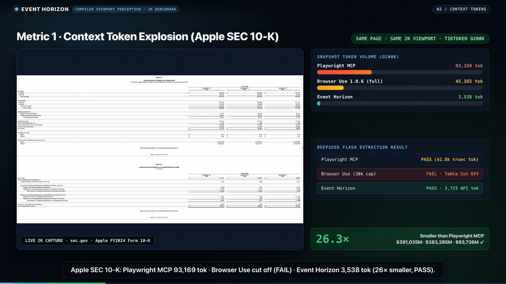
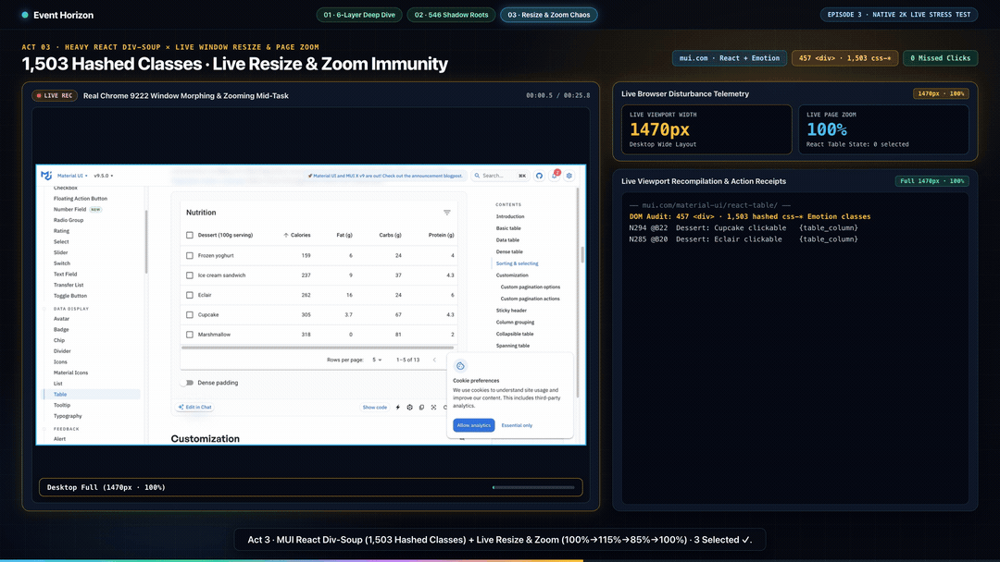

<div align="center">

# Event Horizon

### 面向 AI Browser Agent 的人类物理可见现实层

**基于 MCP 的视口契约编译引擎 —— Token 暴降 91.9%、遮挡误点归零、0 条站点规则。**

[English](README.md) · [中文](README.zh-CN.md) · [官网](https://ehbrowser.com/) · [60 秒免费上手](#60-秒快速上手完全免费--注册即用) · [实测对比](#实测证据视口契约编译-vs-裸-dom--纯视觉) · [为何云端托管与免费](#为什么感知核心放在云端)

</div>

---

## 拖垮网页 Agent 的不是模型不够聪明，而是喂给它的“假布局”

**网页是为人类的眼睛设计的，不是为 DOM 树设计的。**

绝大多数网页 Agent 翻车，根源不在大模型推理能力弱，而在于现有工具喂给模型的是**失真的页面视图**：

- **裸 DOM / 无障碍树倾倒路线**（`Playwright MCP` 等）：动辄把 **20 万+ Token** 的屏幕外隐藏节点一股脑塞进上下文，把被弹窗盖死的底层按钮照样标成“可点击”，也从不告诉模型哪张卡片被屏幕底边截断了一半。
- **纯视觉 / 截屏猜坐标路线**（`Computer Use`、视觉模式 Browser Use）：每步上传大图猜 `(x, y)` 像素坐标，成本高、延迟长、遇到窗口缩放或微调瞬间偏移，抓不住双击才出现的隐藏表格编辑器，还会把用户页面截图传到云端模型。

**Event Horizon 开辟了第三条路线：Compiled Viewport Perception（视口契约编译层）。**

不倾倒裸 HTML/AX Tree，也不上传截图——Event Horizon 把**此刻物理可见且真实可操作的视口画面**编译成极简的结构化**视口契约（Viewport Contract）**交给你的 Agent，并在动作触碰 DOM 之前执行代码级硬安全闸拦截。

---

## 支撑这一层的三个朴素概念

把任何网页去掉纹理、色彩和前端框架噪声，剩下的其实只有两样东西：**几何**（位置、边界、归属）与**语义**（角色、标签、表头）。EH 的全部工程设计，都自然推出自你此刻扫一眼屏幕就能验证的三个概念：

1. **几何导航** — 人看网页，看到的不是 20 万 Token 的 DOM 树，而是一簇簇有边界的几何结构（卡片、表格行、按钮），构成当前平面的二维导航图。
2. **裁切与遮挡即探索信号** — 往下滚时，被切在视口底边的几何就是“下面还有内容”的信号（上、左、右同理）；浮层盖住底层内容时，先处理上层几何，再读底下。
3. **探索完成** — 当前视口反复探索后不再产生新的可见几何，就是可以合法停下的信号。

*Event Horizon 只是这三个概念的工程化表达——把模型看到的世界，对齐到人类真正用来操作网页的公共视觉证据层。*

---

## 浏览器 Agent 技术栈的新一层

| 维度 | 路线一：裸 DOM / 无障碍树<br>*(Playwright MCP 等)* | 路线二：纯视觉 / 截屏猜点<br>*(Computer Use / 视觉 BU)* | **路线三：视口契约编译层**<br>***Event Horizon*** |
| :--- | :--- | :--- | :--- |
| **模型看到什么** | 完整隐藏/屏外文档树（`200k+ tok`） | 高开销 PNG 截图（猜像素坐标） | **紧凑物理可见视口契约（`16.3k tok`）** |
| **弹窗遮挡控件** | 误报为可点（`85 / 90` 漏出） | 靠视觉硬猜、易误点 | **推理前直接剥离（`0 / 90` 漏出）** |
| **Shadow DOM 与 div 汤** | 选择器脆弱、文档树爆炸 | 丢失结构与微小单元格 | **零规则穿透 546 个 Shadow Root** |
| **实时缩窗与页面缩放** | 引用失效、坐标漂移 | 坐标瞬间打偏 | **每步按最新视口重编译 · 0 失误** |
| **隐藏行内编辑器** | 无 `<input>` 直接卡死 | 双击坐标极不稳定 | **自动识别可试编辑并验真落盘** |
| **高危/不可逆操作** | 仅靠 Prompt 祈祷 | 仅靠 Prompt 祈祷 | **代码强制执行 · 触碰 DOM 前硬拦截** |
| **浏览器、IP 与隐私** | 云端托管易封 IP 或重依赖 | 页面截图持续上传云端 VLM | **你的本机 Chrome · 不传截图 · 零内容留存** |

---

## 实测证据：视口契约编译 vs. 裸 DOM & 视觉路线

### 1. 上下文暴降 91.9%、遮挡误报归零（同一 2K 视口三方实测）

在完全相同的 2K 视口（`2560×1440`）下，使用同一个 `deepseek-flash`（`temp=0`）对 5 类公认最难公开网页进行同页实测：

<p align="center">
  
</p>

| 公认高难公开网页 | Playwright MCP | Browser Use 1.0.6 | **Event Horizon** |
| :--- | :---: | :---: | :---: |
| **1. 苹果 SEC 10-K 财报长表** | `93,169 tok` · PASS | `45,365*` · **FAIL（截断漏表）** | **`3,538 tok`（缩小 26×）· PASS** |
| **2. Wikipedia 多层表头长表** | `38,874 tok` · PASS | `11,788 tok` · PASS | **`3,828 tok` · PASS** |
| **3. Bootstrap 5.3 实时弹窗（遮挡 90 控件）** | `16,880 tok` · **85 处漏出** | `8,999 tok` · **82 处漏出** | **`375 tok` · 0 处漏出** |
| **4. 联合国 240 行长列表** | `49,588 tok` · 无折叠 | `14,793 tok` · 无折叠 | **`4,989 tok` · PASS** |
| **5. arXiv 多条件表单** | `2,314 tok` · PASS | `1,383 tok` · PASS | **`3,606 tok` · PASS** |
| **5 页总上下文 / 实测交付** | **`200,825 tok` · 3/5** | **`82,328 tok` · 2/5** | **`16,336 tok` (-91.9%) · 4/5*** |

> *实测口径说明：上述数据来自固定 2K 视口与 `deepseek-flash` 在指定 5 个公开页面上的对照实测，用于展示架构差异，不代表所有网站的通用压缩比或必然成功率。*

---

### 2. 六层自主深潜总账单不到 1 美分（`$0.0093` · 零跑偏）

`deepseek-flash` 自主连续钻取 6 层网页（`Wikipedia 首页 → Python → Guido van Rossum → 阿姆斯特丹大学 → 阿姆斯特丹 → 荷兰`）。全程 **9 次真实 API 调用**，每步上下文平稳维持在 **~3,800 Token** 不滚雪球（总计 `34,581 tok`），5/5 跨层事实全部绑定验真，总花费仅 **`$0.0093`（¥0.066）**。

<p align="center">
  
</p>

---

### 3. 零站点规则穿透 546 个 Shadow DOM

在纯 Web Components 站点 `shoelace.style` 上，无需任何站点规则或选择器，直穿 **546 个开放 `#shadow-root`** —— 点开影子搜索框捕获浮层 `O0`、键入 `Dialog` 跳转 `<sl-dialog>` 并实时切换影子 `React` 选项卡。

<p align="center">
  
</p>

---

### 4. React 混淆类 `div` 汤 + 运行中实时缩窗变倍抗干扰

在 Material UI 复杂表格（`457` 个 `<div>`、`1,503` 个混淆 `css-*` 类名）上，运行中途把真实 Chrome 窗口从全屏连续缩窄并缩放页面（`1470px → 1060px → 880px @ 115% → 1260px @ 85% → 1470px`），触发多轮响应式重排。EH 每步按最新视口重编译契约，依次勾选 `Cupcake`、`Eclair`、`Frozen yoghurt`、排序 `Calories` 并验真 **`3 selected`**，全程零失误。

<p align="center">
  
</p>

---

### 5. 类 Excel 行内编辑 + 触碰 DOM 前的硬安全闸

- **Tabulator 6.x 行内编辑**：双击前 DOM 中并无 `<input>`，EH 自动标出可试编辑单元格，完成 `Oli Bob → Ada Lovelace` 与 `Progress 12 → 95` 并于下一帧验真落盘。
- **引擎层硬安全闸**：在 Wikipedia 登录页，密码框填值与点击 `Log in` 均在**触碰 DOM 前由代码强制拦截**，不受提示词注入影响。

<p align="center">
  
</p>

---

### 6. 不止 5 个演示页：300 轮跨 51 站规模与成本归档（NL50）

短演示容易挑好跑的页面。为验证多站规模下的真实稳定性与模型账单，项目在历史冻结基线上完成了一轮完整的 **NL50** 压测（50 题 × 冷臂 3 轮 + 经验臂 3 轮，全程零人工接管，DeepSeek V4 Flash）：

| 历史规模归档指标（NL50） | 实测数值 |
| :--- | :--- |
| **端到端运行总次数** | **`300` 次**（无经验 `150` + 有经验 `150` · 零人工接管） |
| **带 URL 的页面状态帧** | **`3,680`** |
| **访问的不同 URL 数** | **`498`**（单轮均值 `3.9` / 中位数 `3` / 最大跨 **`39`** 个不同 URL） |
| **不同主机名 / 真实站点（eTLD+1）** | **`88`** 个主机名，覆盖 **`51`** 个不同主域站点 |
| **300 轮模型总成本** | **`$5.52`**（约 40 元；冷臂 `$2.81` + 经验臂 `$2.70`，折合 **`$0.0184` / 次**） |
| **Prompt 输入缓存命中率** | **`95.6%`**（跨 `5,245` 次模型调用：冷臂 `95.63%` / 经验臂 `95.51%`） |
| **原冻结交付门控** | **`298 / 300`**（每臂 `149/150`）· 执行前拦下 `234` 次非法/高危动作 |

> *归档口径说明：以上数字来自历史冻结引擎版本的归档基线（未在当前订阅版上重跑）。通过原冻结交付门控不等同于逐字段人工事实核验，51 个历史覆盖站点亦不代表全站必过承诺；完整口径、严格盲判上下文与原始复核入口见 [历史实测与核对入口](docs/DEMO_EVIDENCE.md)。*

---

## 你的 Agent 实际看到什么？

不再是 9 万 Token 的裸 HTML 或模糊截图，而是与人眼所见严格对齐的紧凑**视口契约**：

```text
[Page] Selenium (software)
[Viewport] top · ~9 screens total
[Active Surface] 3 action targets occluded by foreground layer were removed; use visible targets only
[Frozen Cross-Page Evidence] E0 "Playwright_Developer: Microsoft" @f2 | E3 "Playwright_License: Apache License 2.0" @f2

▸Card[@N328 @M10:O25] ⚠ clipped-bottom
  ▸Card[@N192 @M13:O13]
    N191  @M13   text: Release
    N193  @O13   Release*: 2004; 22 years ago (2004)
  ▸Card[@N198 @M14:O14]
    N207  @M14   title*: Stable release
    N208  @O14   title*: 4.53.0 / 17 November 2026
  ▸Card[@N290 @M22:O22]
    N288  @O22   Operating system: Cross-platform
  ▸Card[@N303 @M25:O25] ⚠ clipped-bottom
    N304  @O25   License*: Apache License 2.0
```

- **杜绝乱点**：被遮挡控件在模型思考前已被彻底清出操作面；
- **语义贴值**：表头自动贴到每个数据格上，便宜小模型也不用靠位置硬数表格列；
- **明确裁切信号（`⚠ clipped-bottom`）**：模型清楚知道哪张卡被屏底切了一半、需要继续下滚核实；
- **跨页证据冻结（`E*`）**：前几页查到的真值跨页保留并绑定页面节点，页面没写就不编造。

---

## 架构与零留存信任模型

- **本机 Chrome · 零共享云端 IP 反爬风险**：所有网页访问完全发生在你电脑上的隔离 Chrome 里，Cookie 与网络身份不离开本机。
- **可审计纯标准库薄客户端**：本仓库仅含零第三方依赖的 Python 薄客户端、本机控制台、连接器与 MCP Skill，你可直接逐行审计代码。
- **不传截图 · 页面内容零持久化**：服务端默认关闭截图采集，页面采样仅在有界易失内存（最长 15 分钟）中短暂交付，不落盘留存。
- **纯文本服务通知**：本机控制台支持展示服务端推送的维护与版本公告（严格纯文本 + 可选 `https://` 链接，不含任何可执行代码）。
- **自带模型与 Agent**：通过一句通用 MCP 接入指令，无缝接入 **Claude Code、Cursor、Codex、OpenCode** 或任何支持本机 MCP 的宿主。

---

## 为什么感知核心放在云端？

Event Horizon 为 AI 操作真实网页带来了新的可能——无论是重度 Shadow DOM、行内可编辑表格，还是多层动态页面，都能以极低成本稳定完成。

能力越强，越需要护栏。为了防止感知核心被滥用、并持续拦截**银行、支付、医疗、凭据输入**等高敏感站点，我作为独立开发者选择在云端托管并维护感知核心；同时将本仓库的薄客户端完全公开、零第三方依赖、逐行可审计，你的 Chrome、Cookie 与网络身份始终留在本地。

**本项目完全免费，注册即用。** 无需激活码、无需申请、无需绑卡，不传截图、页面内容零留存（仅保留单并发公平使用护栏以保障公共服务稳定）。如果 EH 帮到了你，欢迎通过**赞助**一起分担服务器成本。

---

## 60 秒快速上手（完全免费 · 注册即用）

准备 **Python 3.10+**、**Google Chrome** 与任意支持本机 MCP 的 Agent，**无需安装任何 Python 第三方依赖**。

**macOS / Linux：**
```sh
git clone https://github.com/Boundprogress/Event-horizon-MCP.git
cd Event-horizon-MCP
python3 -I -S -B eh.py start
```

**Windows PowerShell：**
```powershell
git clone https://github.com/Boundprogress/Event-horizon-MCP.git
cd Event-horizon-MCP
py -3 -I -S -B eh.py start
```

1. 启动后自动打开本机控制台（支持中英切换）。
2. **使用 GitHub 或 Google 一键登录**（免填表、免 6 位邮箱验证码），也支持常规邮箱注册：完全免费，无需等待或激活码。
3. 点击 **准备本机使用** → **连接浏览器** 启动专属隔离 Chrome。
4. 点击 **复制一句话接入**，发给 **Claude Code / Cursor / Codex / OpenCode** 或任意支持 ACP / 本机命令行的桌面 Agent。生成的接入目录支持**三层自动适配**（全程不暴露明文 Key）：
   - **通道 1（标准 stdio MCP）**：`mcp-config.json` / Codex TOML（直接挂载 17 个 `eh_*` 工具）。
   - **通道 2（ACP `session/new` 与 Python SDK）**：同目录自带 `acp-mcp-servers.json`（标准 Agent Client Protocol 数组格式，也可通过 `client.py mcp-config --host acp` 导出）以及零依赖 Python SDK [`eh_sdk.py`](eh_sdk.py)（`EventHorizonClient.from_console()` / `.acp_mcp_servers()`）。
   - **通道 3（无 MCP 设置页但带终端工具的桌面宿主）**：自动降级到绑定账号的免明文 Key CLI 入口（`client.py tool --console-directory <dir> --name eh_status --args '{}'`），复用完全相同的 17 个工具与安全护栏。

### 可选：Python SDK 与 ACP 直连（零 `pip install`）

```python
from eh_sdk import EventHorizonClient

eh = EventHorizonClient.from_console()

# 直接塞进 ACP (Agent Client Protocol) 的 session/new 参数：
acp_mcp_servers = eh.acp_mcp_servers()

# 或直接从 Python 驱动已连接的本机专属 Chrome：
session = eh.open_session("查看最新版本号", "https://www.python.org/")
obs = session.perceive()
session.close()
```

> 更多文档：[用户文档](docs/README.md) · [能力与边界](docs/CAPABILITIES.md) · [常见问答](docs/FAQ.md) · [与 Browser Use / Playwright MCP 对比](docs/BROWSER_USE_COMPARISON.md)

---

## 边界说明、赞助与反馈

- 当前处于公开测试阶段，不保证所有网站或复杂交互均能一次完成，关键操作与结果请对照实际页面人工核对。
- **完全免费 · 公平使用护栏**：注册即可免费使用，账号采用单并发公平使用限制（`max_sessions=1, max_commands=1`），恶意压测或滥用会被暂停访问；你自己的大模型/Agent 费用另计。
- 普通公开 HTTP(S) 站点无需逐站白名单；私有网络与**银行、支付、医疗、凭据输入**等高敏感场景默认受限。
- **欢迎丢给我们你最头疼的网页**：如果某个 Shadow DOM 站点、复杂表格或业务后台把你的 Browser Agent 搞崩了，欢迎直接提 GitHub Issue。
- **赞助支持**：本项目由独立开发者维护并完全免费开放，如果 EH 帮你省了大量 Token 或研发时间，欢迎通过 [爱发电（Afdian）](https://ifdian.net/a/ehbrowser?tab=home) 自愿赞助支持服务器成本（§1.4）。
- **联系、反馈与申诉**：[pluto@ehbrowser.com](mailto:pluto@ehbrowser.com) · 官网与协议：[https://ehbrowser.com](https://ehbrowser.com/) / [https://ehbrowser.com/terms](https://ehbrowser.com/terms/)。

---

## 许可证

本薄客户端代码采用 **GNU Affero General Public License v3.0 only（`AGPL-3.0-only`）**，详见 [LICENSE](LICENSE) 与 [NOTICE](NOTICE)。使用配套在线服务另行适用客户端内展示的服务使用协议。
