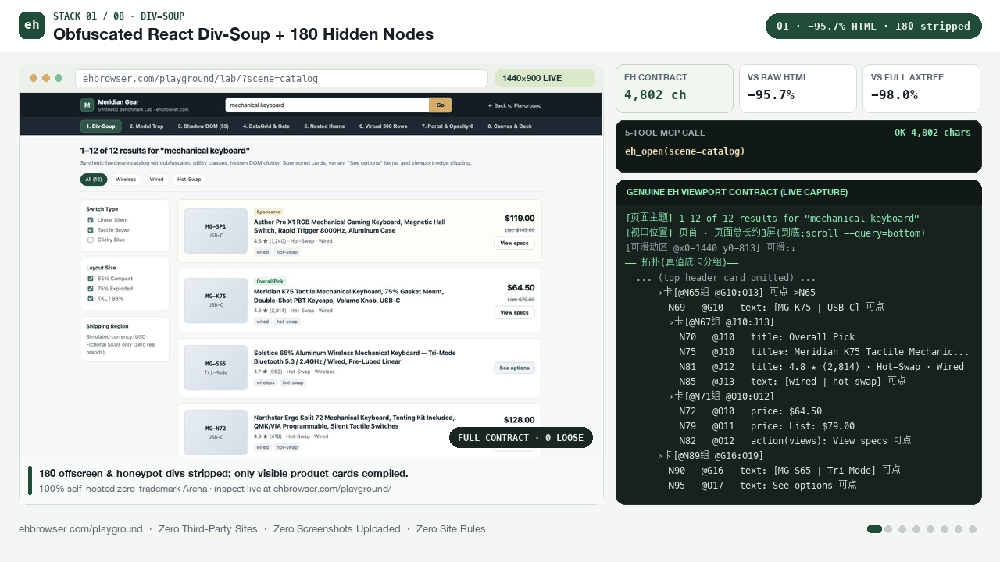
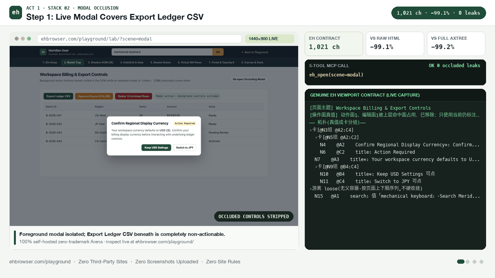
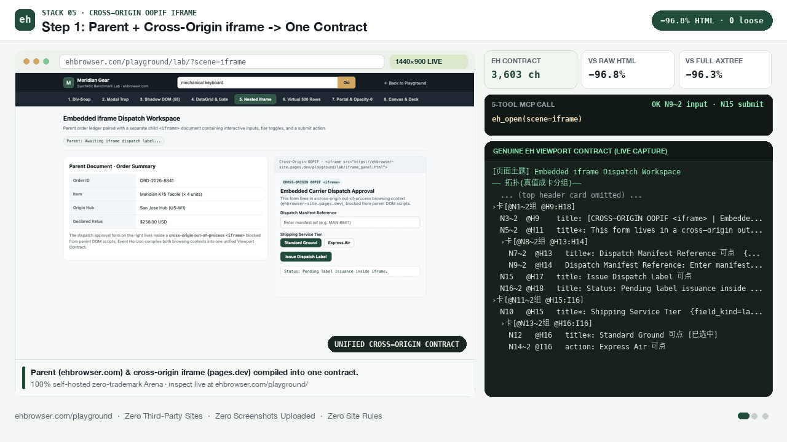
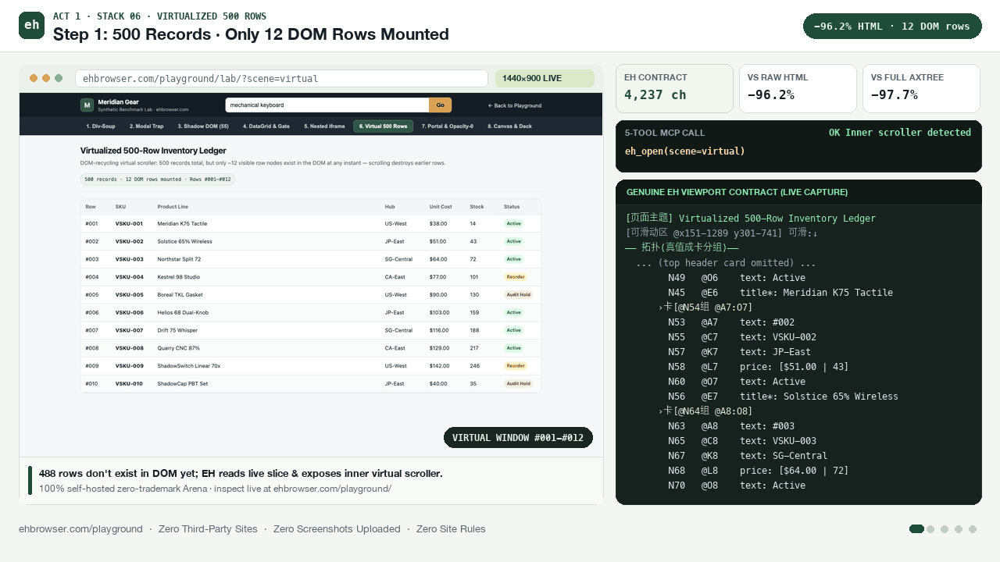
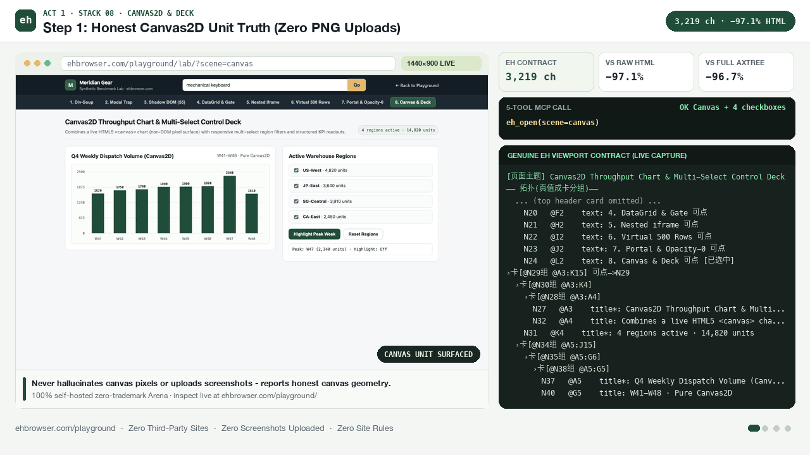

<div align="center">

# Event Horizon

### 面向 AI Browser Agent 的人类物理可见现实层

**基于 MCP 的视口契约编译引擎 —— 8 大高难前端技术栈压减 95%+ 上下文体积、遮挡误点归零、0 条站点规则。**

[English](README.md) · [中文](README.zh-CN.md) · [8 栈在线竞技场（免登录）](https://ehbrowser.com/playground/) · [官网](https://ehbrowser.com/) · [更新日志](CHANGELOG.md) · [60 秒免费上手](#60-秒快速上手完全免费--注册即用) · [为何云端托管与免费](#为什么感知核心放在云端)

</div>

---

## 拖垮网页 Agent 的不是模型不够聪明，而是喂给它的“假布局”

**网页是为人类的眼睛设计的，不是为 DOM 树设计的。**

绝大多数网页 Agent 翻车，根源不在大模型推理能力弱，而在于现有工具喂给模型的是**失真的页面视图**：

- **裸 DOM / 无障碍树倾倒路线**（`Playwright MCP` 等）：动辄把 **20 万+ Token** 的屏幕外隐藏节点一股脑塞进上下文，把被弹窗盖死的底层按钮照样标成“可点击”，也从不告诉模型哪张卡片被屏幕底边截断了一半。
- **纯视觉 / 截屏猜坐标路线**（`Computer Use`、视觉模式 Browser Use）：每步上传大图猜 `(x, y)` 像素坐标，成本高、延迟长、遇到窗口缩放或微调瞬间偏移，抓不住双击才出现的隐藏表格编辑器，还会把用户页面截图传到云端模型。

**Event Horizon 开辟了第三条路线：Compiled Viewport Perception（视口契约编译层）。**

不倾倒裸 HTML/AX Tree，也不上传截图——Event Horizon 把**此刻物理可见且真实可操作的视口画面**编译成极简的结构化**视口契约（Viewport Contract）**交给你的 Agent，并在动作触碰 DOM 之前执行代码级硬安全闸拦截。

---

## 支撑这一层的三个朴素概念

把任何网页去掉纹理、色彩和前端框架噪声，剩下的其实只有两样东西：**几何**（位置、边界、归属）与**语义**（角色、标签、表头）。EH 的全部工程设计，都自然推出自你此刻扫一眼屏幕就能验证的三个概念：

1. **几何导航** — 人看网页，看到的不是 20 万 Token 的 DOM 树，而是一簇簇有边界的几何结构（卡片、表格行、按钮），构成当前平面的二维导航图。
2. **裁切与遮挡即探索信号** — 往下滚时，被切在视口底边的几何就是“下面还有内容”的信号（上、左、右同理）；浮层盖住底层内容时，先处理上层几何，再读底下。
3. **探索完成** — 当前视口反复探索后不再产生新的可见几何，就是可以合法停下的信号。

*Event Horizon 只是这三个概念的工程化表达——把模型看到的世界，对齐到人类真正用来操作网页的公共视觉证据层。*

---

## 浏览器 Agent 技术栈的新一层

| 维度 | 路线一：裸 DOM / 无障碍树<br>*(Playwright MCP 等)* | 路线二：纯视觉 / 截屏猜点<br>*(Computer Use / 视觉 BU)* | **路线三：视口契约编译层**<br>***Event Horizon*** |
| :--- | :--- | :--- | :--- |
| **模型看到什么** | 完整隐藏/屏外文档树（单屏 `112k–235k 字符`） | 高开销 PNG 截图（猜像素坐标） | **紧凑物理可见视口契约（`1.0k–5.2k 字符` · `-95.3% 至 -99.1%`）** |
| **弹窗遮挡控件** | 隔着蒙层照常暴露为可点 | 靠视觉硬猜、易误点 | **推理前物理剥离（`0` 遮挡漏出）** |
| **Shadow DOM、跨域 iframe 与 Portal** | 同源策略阻断 / 选择器脆弱 / 树体膨胀 | 丢失结构与微小控件 | **55 层 ShadowRoot + 跨域 OOPIF + Body Portal 统一编入 · 0 规则** |
| **虚拟滚动列表（DOM 回收）** | 未挂载行缺失、滚过即销毁 | 每滚一步重传大图 | **内部虚拟滚轮 + 跨滚动证据 `E*` 冻结，DOM 回收后不丢事实** |
| **Canvas2D 与 `opacity:0` 透明壳** | 透明按钮壳失灵或放宽遮挡闸 | 持续上传高开销截图 | **诚实画布几何真值（0 截图上传）+ 精准绑定透明原生壳** |
| **高危/不可逆操作** | 仅靠 Prompt 祈祷 | 仅靠 Prompt 祈祷 | **代码强制执行 · 触碰 DOM 前硬拦截（`dom_touched: false`）** |
| **浏览器、IP 与隐私** | 云端托管易封 IP 或重依赖 | 页面截图持续上传云端 VLM | **你的本机 Chrome · 不传截图 · 零内容留存** |

---

## 实测证据：8 技术栈前端竞技场（100% 自托管 · 可 F12 核验）

不挑外部商业站凑演示——下方全部录屏与实测数据均直采自 **100% 自托管、零第三方商标的 [8 栈前端竞技场](https://ehbrowser.com/playground/)**（[源实验页](https://ehbrowser.com/playground/lab/)）。在浏览器打开按 **F12**，即可亲手核验每一个 DOM 陷阱、ShadowRoot、跨域 `<iframe>`、虚拟滚动行与返回的完整视口契约。

### 1. 八大高难前端技术栈 → 统一编译为同一张视口契约

<p align="center">
  
</p>

| 自托管竞技场技术栈（`1440×900` · 可按 F12 核对） | Raw DOM HTML | 完整 AXTree | **Event Horizon 视口契约与实测操作** |
| :--- | :---: | :---: | :--- |
| **1. 混淆 Div-Soup 商品列表** *(含 180 隐藏噪声节点)* | `112,040 ch` | `235,649 ch` | **`4,802 → 3,168 ch`**（`-95.7% / -98.0%`）· 增量滚动 + `E0` ✓ |
| **2. 弹窗物理遮挡陷阱** *(`z-index: 1200` 全屏蒙层)* | `112,034 ch` | `120,910 ch` | **`1,021 ch`**（`-99.1% / -99.2%`）· **0 泄漏** → 解锁 CSV ✓ |
| **3. 55 层嵌套开放 Shadow DOM** *(0 轻 DOM SKU)* | `112,031 ch` | `225,045 ch` | **`5,229 ch`**（`-95.3% / -97.7%`）· 实点 `N70` → `Selected ✓` |
| **4. ARIA Combobox + DataGrid + 敏感操作边界** | `112,040 ch` | `124,585 ch` | **`3,939 ch`**（`-96.5% / -96.8%`）· 登录与密码 **碰 DOM 前拦截** ✓ |
| **5. 跨域跨进程 OOPIF `<iframe>`** *(`ehbrowser.com → pages.dev`)* | `112,038 ch` | `98,006 ch` | **`3,603 ch`**（`-96.8% / -96.3%`）· 跨帧填 `N9~2` + 提交 `N15` ✓ |
| **6. 500 行 DOM 回收虚拟滚动长表** *(仅挂载 12 行)* | `112,040 ch` | `184,232 ch` | **`4,237 → 3,820 ch`**（`-96.2% / -97.7%`）· `E0` 跨回收保留 ✓ |
| **7. body 挂载游离 Portal 日历 + `opacity:0` 原生壳** | `112,045 ch` | `119,112 ch` | **`2,902 ch`**（`-97.4% / -97.6%`）· 选 12/18 + 透明按钮确认 ✓ |
| **8. HTML5 Canvas2D 图表 + 响应式多选控制板** | `112,041 ch` | `98,054 ch` | **`3,219 ch`**（`-97.1% / -96.7%`）· 诚实画布 + W47 重绘 ✓ |

> *100% 真实引擎在 `1440×900` 视口实采，零站点规则、零截图上传、零 `<html>` 游离冗余。欢迎免登录直达 [ehbrowser.com/playground/](https://ehbrowser.com/playground/) 逐帧检视全部 8 份完整契约。*

---

### 2. 弹窗物理遮挡隔离（`0` 泄漏）+ 55 层开放 Shadow DOM 穿透实点

- **第一幕（弹窗遮挡）**：`z-index: 1200` 币种弹窗盖住底层 `Export Ledger CSV` 按钮，EH 仅输出 `1,021` 字符前景契约（`-99.1%`），底层按钮 0 泄漏；点击 `Keep USD Settings` 后即刻解锁 `N46`。
- **第二幕（55 层 Shadow DOM）**：55 个嵌套开放 `#shadow-root` 下共有 `0` 个轻 DOM SKU 节点，EH 零规则穿透并实点 `Inspect SKU`（`N70`）→ 验真 **`Selected ✓`**。

<p align="center">
  
</p>

---

### 3. 跨域跨进程 OOPIF `<iframe>` 统一编入、填表与双端验真

常规 DOM 脚本在跨域 `<iframe>` 前会撞上浏览器同源策略硬墙（`SecurityError`）。Event Horizon 将顶页订单（`ehbrowser.com`）与跨域跨进程子帧（`ehbrowser-site.pages.dev`）编入同一视口契约，通过跨帧消歧短号 **`N9~2`** 精准填入 **`MAN8841`**（顶页搜索框纹丝不动），再点 **`N15`** 签发标签，子帧与顶页 `postMessage` 双端同步验真 **`Label Issued · MAN8841 · Standard Ground ✓`**。

<p align="center">
  
</p>

---

### 4. 500 行 DOM 回收虚拟滚动（`E0` 冻结）+ Body 游离 Portal 日历与 `opacity:0` 透明壳

- **第一幕（虚拟滚动 DOM 回收）**：500 条库存记录同一时刻 DOM 仅挂载 12 行。EH 在滚动内部虚拟容器（`#001–#012` → `#007–#018`）销毁第 2 行之前，先把 `VSKU-002` 冻结为跨滚动审计证据 **`E0`**，滚动后增量契约依然完整保留 `E0`。
- **第二幕（Body Portal + `opacity:0` 原生按钮壳）**：点开挂在 `document.body` 末尾（脱离表单子树）的日历 Portal 选中 **12/18（`2026-12-18`）**，再精准命中 `opacity:0` 原生确认按钮壳 → 验真 **`Schedule Confirmed ✓`**。

<p align="center">
  
</p>

---

### 5. 诚实 HTML5 Canvas2D 真值（不传截图）+ 触碰 DOM 前硬安全闸

- **第一幕（Canvas2D）**：不上传高开销截图、也不臆测柱状图像素，而是诚实标注画布单元几何与右侧多选区域控件；点击 `Highlight Peak Week`（`N59`）实时将峰值周 **W47** 重绘琥珀高亮，契约同步验真 **`Highlight: On ✓`**。
- **第二幕（碰 DOM 前硬安全闸）**：点击 `Sign in`（`N70`）与向 `type="password"`（`N64`）输入凭据均在**触碰 DOM 前由确定性代码强制拦截**（`ok: false`、`dom_touched: false`），免疫提示词注入。

<p align="center">
  
</p>

---

### 6. 不止 5 个演示页：300 轮跨 51 站规模与成本归档（NL50）

短演示容易挑好跑的页面。为验证多站规模下的真实稳定性与模型账单，项目在历史冻结基线上完成了一轮完整的 **NL50** 压测（50 题 × 冷臂 3 轮 + 经验臂 3 轮，全程零人工接管，DeepSeek V4 Flash）：

| 历史规模归档指标（NL50） | 实测数值 |
| :--- | :--- |
| **端到端运行总次数** | **`300` 次**（无经验 `150` + 有经验 `150` · 零人工接管） |
| **带 URL 的页面状态帧** | **`3,680`** |
| **访问的不同 URL 数** | **`498`**（单轮均值 `3.9` / 中位数 `3` / 最大跨 **`39`** 个不同 URL） |
| **不同主机名 / 真实站点（eTLD+1）** | **`88`** 个主机名，覆盖 **`51`** 个不同主域站点 |
| **300 轮模型总成本** | **`$5.52`**（约 40 元；冷臂 `$2.81` + 经验臂 `$2.70`，折合 **`$0.0184` / 次**） |
| **Prompt 输入缓存命中率** | **`95.6%`**（跨 `5,245` 次模型调用：冷臂 `95.63%` / 经验臂 `95.51%`） |
| **原冻结交付门控** | **`298 / 300`**（每臂 `149/150`）· 执行前拦下 `234` 次非法/高危动作 |

> *归档口径说明：以上数字来自历史冻结引擎版本的归档基线（未在当前订阅版上重跑）。通过原冻结交付门控不等同于逐字段人工事实核验，51 个历史覆盖站点亦不代表全站必过承诺；完整口径、严格盲判上下文与原始复核入口见 [历史实测与核对入口](docs/DEMO_EVIDENCE.md)。*

---

## 你的 Agent 实际看到什么？

不再是 9 万 Token 的裸 HTML 或模糊截图，而是与人眼所见严格对齐的紧凑**视口契约**：

```text
[页面主题] Embedded iframe Dispatch Workspace (ehbrowser.com)
[跨域 OOPIF] 顶页与 pages.dev 子 <iframe> 统一编入同一张视口契约
[已审计证据] E0 "VSKU-002 · Solstice 65% Wireless · $51.00"（跨虚拟滚动 DOM 回收保留）

▸卡[@N35组 @B8:E15]  Parent Document · Order Summary
  N42   @E9    Order ID*: ORD-2026-8841   {field_source=table_row_th}
  N47   @E11   Item*: Meridian K75 Tactile (× 4 units)
  N53   @E14   Declared Value: $258.00 USD
▸卡[@N1~2组 @I10:J20]  Cross-Origin OOPIF <iframe>
  N9~2  @I15   Dispatch Manifest Reference: 值「MAN8841」 可编辑
  N12   @I18   Standard Ground 可点 [已选中]
  N15   @I19   Issue Dispatch Label 可点
  N16~2 @I20   Status: Label Issued · MAN8841 · Standard Ground ✓
```

- **杜绝乱点**：被遮挡控件在模型思考前已被彻底清出操作面；
- **语义贴值**：表头自动贴到每个数据格上，便宜小模型也不用靠位置硬数表格列；
- **明确裁切信号（`⚠ clipped-bottom`）**：模型清楚知道哪张卡被屏底切了一半、需要继续下滚核实；
- **跨页证据冻结（`E*`）**：前几页查到的真值跨页保留并绑定页面节点，页面没写就不编造。

---

## 架构与零留存信任模型

- **本机 Chrome · 零共享云端 IP 反爬风险**：所有网页访问完全发生在你电脑上的隔离 Chrome 里，Cookie 与网络身份不离开本机。
- **可审计纯标准库薄客户端**：本仓库仅含零第三方依赖的 Python 薄客户端、本机控制台、连接器与 MCP Skill，你可直接逐行审计代码。
- **不传截图 · 页面内容零持久化**：服务端默认关闭截图采集，页面采样仅在有界易失内存（最长 15 分钟）中短暂交付，不落盘留存。
- **纯文本服务通知**：本机控制台支持展示服务端推送的维护与版本公告（严格纯文本 + 可选 `https://` 链接，不含任何可执行代码）。
- **自带模型与 Agent**：通过一句通用 MCP 接入指令，无缝接入 **Claude Code、Cursor、Codex、OpenCode** 或任何支持本机 MCP 的宿主。

---

## 为什么感知核心放在云端？

直说两点实际原因：

1. **核心暂不开源**：视口编译感知核心是独立打磨的核心实现，目前仍处于保护期，暂不打算开源。
2. **控制合规与滥用风险**：浏览器自动化涉及不少灰产、隐私与法律风险；将核心托管在服务端至少能对**银行、支付、医疗、凭据输入**等高敏感场景保持统一硬拦截，并在发生滥用时及时止损。

作为平衡，本仓库的薄客户端保持 **100% 开源（AGPL-3.0-only）、纯 Python 标准库零依赖、逐行可审计**——默认拉起本机独立临时 Chrome，你的 Cookie 与网络身份不离开本机，发往云端的每一条数据都可以直接看源码核对。

**本项目面向个人完全免费，注册即用。** 无需激活码、无需申请、无需绑卡，不传截图、页面内容零持久化（仅保留单并发公平使用护栏以保障公共服务稳定）。如果 EH 帮到了你，欢迎通过 [爱发电（Afdian）](https://ifdian.net/a/ehbrowser?tab=home) 自愿赞助，一起分担服务器成本。

---

## 60 秒快速上手（完全免费 · 注册即用）

准备 **Python 3.10+**、**Google Chrome** 与任意支持本机 MCP 的 Agent，**无需安装任何 Python 第三方依赖**。

**macOS / Linux：**
```sh
git clone https://github.com/Boundprogress/Event-horizon-MCP.git
cd Event-horizon-MCP
python3 -I -S -B eh.py start
```

**Windows PowerShell：**
```powershell
git clone https://github.com/Boundprogress/Event-horizon-MCP.git
cd Event-horizon-MCP
py -3 -I -S -B eh.py start
```

1. 启动后自动打开本机控制台（支持中英切换）。
2. **使用 GitHub 或 Google 一键登录**（免填表、免 6 位邮箱验证码），也支持常规邮箱注册：完全免费，无需等待或激活码。
3. 点击 **准备本机使用** → **连接浏览器** 启动专属隔离 Chrome。
4. 点击 **复制一句话接入**，发给 **Claude Code / Cursor / Codex / OpenCode** 或任意支持 ACP / 本机命令行的桌面 Agent。生成的接入目录支持**三层自动适配**（全程不暴露明文 Key）：
   - **通道 1（标准 stdio MCP）**：`mcp-config.json` / Codex TOML（直接挂载 17 个 `eh_*` 工具）。
   - **通道 2（ACP `session/new` 与 Python SDK）**：同目录自带 `acp-mcp-servers.json`（标准 Agent Client Protocol 数组格式，也可通过 `client.py mcp-config --host acp` 导出）以及零依赖 Python SDK [`eh_sdk.py`](eh_sdk.py)（`EventHorizonClient.from_console()` / `.acp_mcp_servers()`）。
   - **通道 3（无 MCP 设置页但带终端工具的桌面宿主）**：自动降级到绑定账号的免明文 Key CLI 入口（`client.py tool --console-directory <dir> --name eh_status --args '{}'`），复用完全相同的 17 个工具与安全护栏。

### 可选：Python SDK 与 ACP 直连（零 `pip install`）

```python
from eh_sdk import EventHorizonClient

eh = EventHorizonClient.from_console()

# 直接塞进 ACP (Agent Client Protocol) 的 session/new 参数：
acp_mcp_servers = eh.acp_mcp_servers()

# 或直接从 Python 驱动已连接的本机专属 Chrome：
session = eh.open_session("查看最新版本号", "https://www.python.org/")
obs = session.perceive()
session.close()
```

> 更多文档：[用户文档](docs/README.md) · [能力与边界](docs/CAPABILITIES.md) · [常见问答](docs/FAQ.md) · [与 Browser Use / Playwright MCP 对比](docs/BROWSER_USE_COMPARISON.md)

---

## 边界说明、赞助与反馈

- 当前处于公开测试阶段，不保证所有网站或复杂交互均能一次完成，关键操作与结果请对照实际页面人工核对。
- **完全免费 · 公平使用护栏**：注册即可免费使用，账号采用单并发公平使用限制（`max_sessions=1, max_commands=1`），恶意压测或滥用会被暂停访问；你自己的大模型/Agent 费用另计。
- 普通公开 HTTP(S) 站点无需逐站白名单；私有网络与**银行、支付、医疗、凭据输入**等高敏感场景默认受限。
- **欢迎丢给我们你最头疼的网页**：如果某个 Shadow DOM 站点、复杂表格或业务后台把你的 Browser Agent 搞崩了，欢迎直接提 GitHub Issue。
- **赞助支持**：本项目由独立开发者维护并完全免费开放，如果 EH 帮你省了大量 Token 或研发时间，欢迎通过 [爱发电（Afdian）](https://ifdian.net/a/ehbrowser?tab=home) 自愿赞助支持服务器成本（§1.4）。
- **联系、反馈与申诉**：[pluto@ehbrowser.com](mailto:pluto@ehbrowser.com) · 官网与协议：[https://ehbrowser.com](https://ehbrowser.com/) / [https://ehbrowser.com/terms](https://ehbrowser.com/terms/)。

---

## 许可证

本薄客户端代码采用 **GNU Affero General Public License v3.0 only（`AGPL-3.0-only`）**，详见 [LICENSE](LICENSE) 与 [NOTICE](NOTICE)。使用配套在线服务另行适用客户端内展示的服务使用协议。
